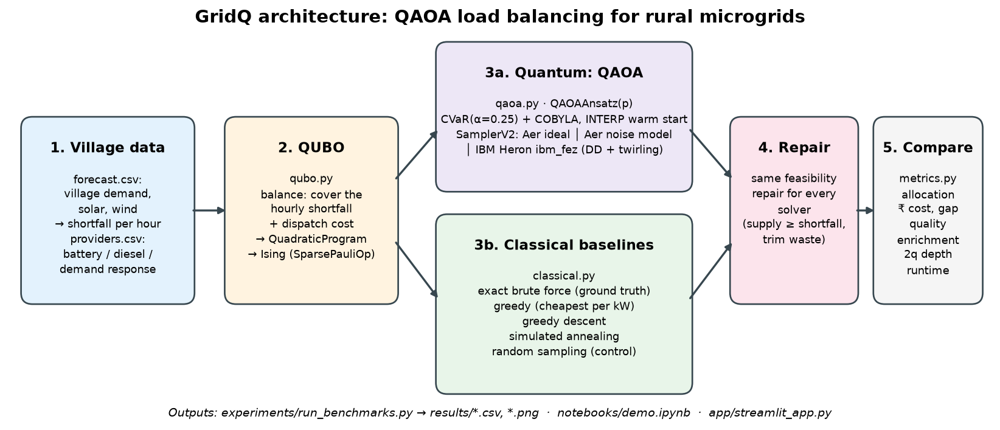
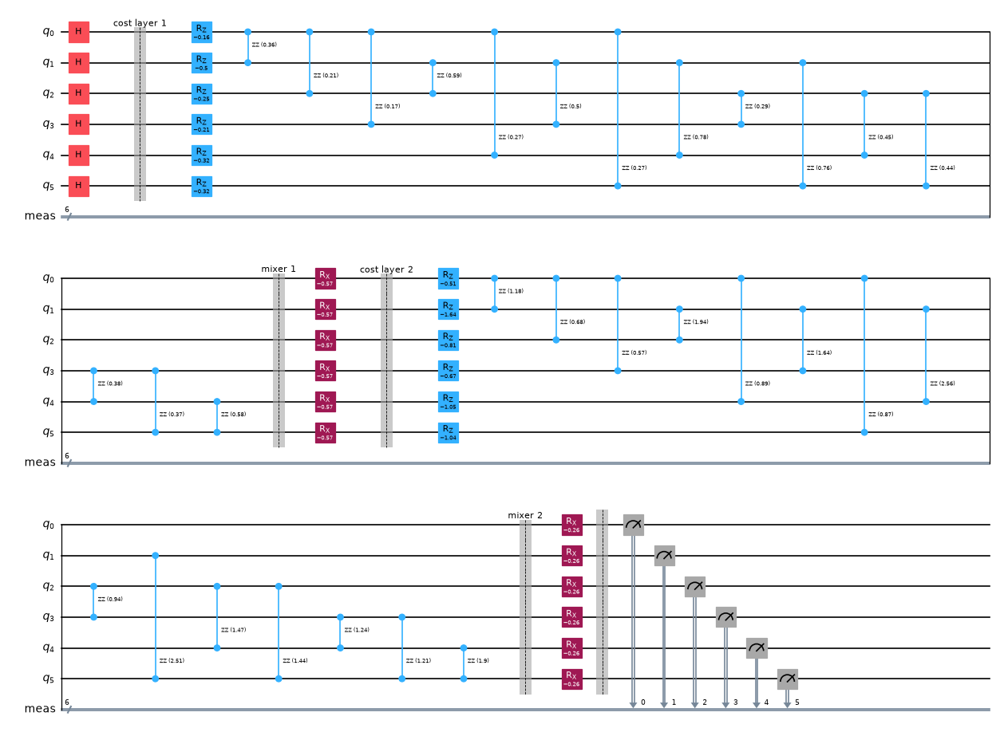

# GridQ: QAOA load balancing for rural microgrids

**IBM Qiskit Fall Fest 2026 · 48-Hour Quantum for Humanity Hackathon · Track 2: Climate, Energy & Agriculture**

> At 19:00 the sun sets and village demand peaks: lights, cooking, fridges, the water pump.
> The microgrid operator must choose which flexible assets to switch on (batteries, a diesel genset,
> demand-response contracts) to cover the shortfall **at the lowest cost**. Today that is done by
> rule of thumb, and the fallback
> is "run the diesel". GridQ formulates the decision as a QUBO, solves it with QAOA on Qiskit Runtime
> primitives, and benchmarks the result honestly against classical solvers.



**Team:** _TBD_ · **Track:** Climate · **Mentors:** Bharadwaj Mummaneni, Phalak Bhatnagar · **Licence:** Apache-2.0

---

## 1. Problem

| | |
|---|---|
| Who benefits | Rural communities on solar/wind/battery microgrids, and the small operators who run them |
| Decision | For one dispatch interval: which of the *n* flexible assets (6–12) to switch on |
| Constraint | Supply ≥ deficit. The village is one shared pool, so every source can serve the deficit (no line limits) |
| Objective | Minimise running cost (₹) |
| Data | **100% synthetic** village master data in [`data/villages/`](data/villages/) (see §1.1). No real customer or utility data |

### 1.1 Village master data (`data/villages/<village>/`)

Every village is a folder of two plain CSV files that you can open in Excel or edit by hand:

| File | Contents |
|---|---|
| `forecast.csv` | 24-hour **village** forecast: total `demand_kw`, `solar_kw` and `wind_kw`. The demand curve is synthetic, built from typical daily patterns: an evening peak from homes, daytime load from the school and clinic, pumping morning and evening |
| `providers.csv` | One row per **flexible provider**: `site_name`, `site_type`, `provider_type` (battery / diesel / demand_response), `capacity_kw`, `price_inr_per_kwh` |
| `village.json` | Name, seed and notes |

For each hour: **shortfall = village demand − solar − wind**. The providers must cover it. All providers feed one shared village pool, so any of them can serve the shortfall, and demand response counts the same as supply. Shipped villages: `village_n6_s0`, `village_n8_s0` (the demo), `village_n8_s1`, `village_n10_s0` and `village_n12_s0`. Regenerate them with `python scripts/export_villages.py`, or edit the CSVs to use your own figures. The dashboard reads whatever is in the folder.

The benchmark experiments (§4.1–4.4) use many randomly generated instances (`make_microgrid(n, seed)`) with the same assets. In those, the deficit is set to 45% of total flexible capacity, so every instance is equally hard.

## 2. QUBO formulation (`src/gridq/qubo.py`)

One binary variable per flexible source, so **one qubit per site**. Every source, including demand response (cutting use counts the same as adding supply), feeds one shared village pool.

$$
H(x)=A\Big(\sum_i \tfrac{p_i}{D}\,x_i-1\Big)^2+\sum_i \tilde c_i\,x_i
$$

| Term | Meaning | Weight |
|---|---|---|
| balance | switched-on power $p_i$ should cover the village deficit $D$ | A = 20 |
| cost | normalised running cost $\tilde c_i$ (all costs sum to 1) | 1 |

This is a **minimum-cost covering (knapsack-type) problem**. Expanding the squared balance term creates a coupling $2A\,p_ip_j/D^2$ between *every* pair of sources, so the QUBO's problem graph is complete. That is the starting point for the density study in §4.3.

The QUBO is built as a `qiskit_optimization.QuadraticProgram`, converted to an Ising `SparsePauliOp`, and normalised so QAOA angles transfer across instances.

**The QAOA circuit** (`gridq.qaoa.readable_circuit`). One qubit per provider; measuring 1 means "switch on".
- **H** on every qubit: an equal superposition of all 2ⁿ dispatches.
- Each layer has a **cost** part, with **RZ** on each qubit (the provider's cost and kW) and **ZZ** on every pair (the balance term), followed by a **mixer** part, with **RX** on every qubit.
- Then measure.

For 6 providers and p = 2 that is 30 ZZ gates. Compiled for an IBM Heron chip, it becomes 105 CZ gates with two-qubit depth 77, because SWAPs are needed for the heavy-hex wiring. The trained circuit that ran on `ibm_kingston`:



It is also shown in the notebook (cell 4b) and the dashboard (dispatch page and hardware page).

**Feasibility repair.** A squared penalty cannot encode `supply ≥ deficit` exactly. So **every solver's output, quantum or classical**, goes through the same repair step (`classical.repair`): add the cheapest-per-kW asset while short, then trim waste. This keeps the comparison like-for-like.

## 3. Methods

| Solver | File | Notes |
|---|---|---|
| **Exact** (constrained brute force) | `classical.py` | Ground truth; 2¹² = 4096 states is trivial |
| **Operator rule** | `classical.py` | Cheapest-per-kW first until covered (what operators do by hand) |
| **Greedy descent** | `classical.py` | Best single bit-flip on the QUBO until stuck |
| **Simulated annealing** | `classical.py` | Metropolis, geometric schedule, 500 sweeps × 5 restarts |
| **Random sampling** | `classical.py` | *Control:* uniform bitstrings + same repair, same shot budget as QAOA |
| **QAOA** | `qaoa.py` | `QAOAAnsatz(p)`, **CVaR(α = 0.25)** objective, COBYLA, p = 1 grid-search initialisation, **INTERP** warm start between depths, `SamplerV2` |

**QAOA execution path.**
1. Angles are trained noise-free on an exact simulator. This is `fast_qaoa_probs`, a NumPy re-implementation of the ansatz that is about 100× faster than building circuits. A unit test checks it against `qiskit.quantum_info.Statevector` to within 1e-10.
2. The trained circuit is transpiled at optimisation level 3.
3. It is then sampled on one of:
   - Aer ideal
   - Aer with the noise model of an IBM Heron r2 snapshot (`FakeFez`)
   - **real IBM hardware** via `qiskit_ibm_runtime.SamplerV2`, with dynamical decoupling (XpXm) plus gate and measurement twirling

## 4. Results

Reproduce with `python experiments/run_benchmarks.py` (≈ 4 min on a laptop). 10 random instances per setting. Raw CSVs and plots are in [`results/`](results/).

### 4.1 Solver comparison (`results/comparison_table.csv`)

`quality` = 1 for the exact optimum and 0 for the worst feasible dispatch. `optimal` = share of instances where the exact optimum was found. `saved` = cost saving vs a *diesel-first* policy.

| Solver | n = 6 quality / optimal | n = 8 | n = 10 | n = 12 quality | saved (n = 8) | runtime (n = 10) |
|---|---|---|---|---|---|---|
| Exact | 1.000 / 100% | 1.000 / 100% | 1.000 / 100% | 1.000 | 60.8% | **0.05 ms** |
| **QAOA p = 3** (ideal, 256 shots) | 1.000 / 100% | 1.000 / 100% | 1.000 / 100% | 1.000 | 60.8% | 488 ms |
| Random sampling (256 shots) | 1.000 / 100% | 1.000 / 100% | 1.000 / 100% | 1.000 | 60.8% | 4 ms |
| Operator rule (cheapest per kW first) | 0.994 / 80% | 0.981 / 50% | 0.995 / 80% | 0.994 | 59.1% | 0.02 ms |
| Simulated annealing | 0.968 / 60% | 0.956 / 20% | 0.944 / 40% | 0.961 | 56.9% | 46 ms |
| Greedy descent | 0.697 / 10% | 0.618 / 0% | 0.611 / 0% | 0.523 | 27.5% | 0.05 ms |

Without line limits, the problem is a pure minimum-cost covering problem, and the operator's cheapest-per-kW rule is already a strong heuristic (98–99% quality). It misses the optimum when a slightly dearer but better-sized combination fits the deficit more tightly.

### 4.2 Does the quantum circuit help? Enrichment vs depth (`results/depth_sweep.png`)

The **enrichment** is P(sampling the optimal dispatch) ÷ P(random guess).

| p | 1 | 2 | 3 | 4 | 5 |
|---|---|---|---|---|---|
| enrichment (n = 8, ideal) | 2.4× | 3.5× | 4.6× | 5.5× | 6.0× |
| 2-qubit depth (generic transpile) | 26 | 42 | 58 | 74 | 90 |

CVaR(α = 0.25) gives about 20–40% more enrichment than the plain expectation value at the same depth. We measured 3.5× vs 2.5× at n = 8, p = 2, and 3.8× vs 3.2× at n = 12, p = 3.

### 4.3 Convergence vs problem-graph density (`results/density_sweep.png`)

The village is one shared pool, so there is no physical line graph. "Graph density" here means the **QUBO's problem graph**: one node per qubit, and one edge per non-zero coupling $Q_{ij}$. Each edge becomes a two-qubit ZZ gate in every QAOA layer. The full balance term couples every pair, so the full graph has density 1.0.

To study density, we **keep only the strongest k% of couplings** (`gridq.sparsify_qubo`), train QAOA (p = 2, CVaR, up to 1,000 COBYLA evaluations) on that sparser model, and score it against the **true** optimum. 10 instances per point; enrichment is the median.

| problem-graph density | 0.2 | 0.4 | 0.6 | 0.8 | 1.0 (full) |
|---|---|---|---|---|---|
| couplings kept, n = 8 / n = 10 | 6 / 9 | 11 / 18 | 17 / 27 | 22 / 36 | 28 / 45 |
| **optimiser evaluations to converge**, n = 8 | 35 | 31 | 63 | 161 | **841** |
| optimiser evaluations to converge, n = 10 | 25 | 56 | 64 | 150 | **899** |
| 2-qubit depth, n = 8 / n = 10 | 20 / 26 | 28 / 38 | 36 / 47 | 40 / 52 | 42 / 54 |
| sparse model's optimum = true optimum (n = 8 / n = 10) | 0% / 0% | 0% / 0% | 10% / 0% | 40% / 30% | 100% / 100% |
| enrichment of true optimum, n = 8 | 0.4× | 1.4× | 5.7× | 7.2× | 3.3× |
| enrichment of true optimum, n = 10 | 0.01× | 0.06× | 0.12× | 0.26× | 3.8× |

**Findings**
- **Convergence slows sharply with density.** Optimiser evaluations rise from about 30 at density 0.2–0.4 to about 850 at full density, roughly 25× more. Sparse problem graphs give smoother landscapes that COBYLA settles quickly.
- **Circuit cost rises with density.** Two-qubit depth goes from 20 to 42 at n = 8, and from 26 to 54 at n = 10. On noisy hardware, that is the main reason to want sparser graphs.
- **The balance constraint is truly all-to-all.** Dropping couplings changes which dispatch is optimal. Below density 0.6 the sparse model almost never has the true optimum, and at n = 10 even density 0.8 points QAOA at the wrong answer (0.26×, worse than random). Only the full graph reliably targets the true optimum (3.3–3.8×).
- At n = 8, densities 0.6–0.8 show high enrichment for the true optimum on some instances. That is luck, not design: the sparse optimum is a near neighbour of the true one. It does not carry over to n = 10.
- **Conclusion:** this problem cannot be made cheaper for QAOA by simply sparsifying. Lower depth would need a reformulation (for example, splitting the village into sub-pools with their own balance terms), and that trades optimality for circuit size.

### 4.4 Noise (`results/noise.png`): ideal vs IBM Heron noise model, n = 6

| p | ideal enrichment | noisy enrichment | 2q gates ideal → on-device |
|---|---|---|---|
| 1 | 2.15× | 1.97× | 30 → 53 |
| 2 | 2.77× | 2.14× | 60 → 105 |
| 3 | 2.92× | 2.23× | 90 → 167 |

Routing onto the heavy-hex topology adds SWAPs and roughly doubles the 2-qubit gate count. **Under noise, gains beyond p = 2 almost disappear.** Deeper circuits add as much error as they remove.

### 4.5 Real IBM Quantum hardware: `ibm_kingston` (Heron r2), n = 6, p = 2

Instance `make_microgrid(6, seed=0)`: 6 providers, shortfall 11.6 kW. 4,096 shots per run, 26 Nov 2026, on the current model. Raw counts and job IDs are in [`results/hardware_ibm_kingston_n6_p2_s0.json`](results/hardware_ibm_kingston_n6_p2_s0.json).

| Run | P(optimal) ± 1σ | Enrichment vs random | ⟨H⟩ | Fidelity to ideal distribution | Optimal dispatch found? |
|---|---|---|---|---|---|
| Ideal (exact simulation) | 0.044 ± 0.003 | 2.82× | 2.06 | 1.000 | ✔ |
| FakeFez noise model (Heron r2 snapshot) | 0.037 ± 0.003 | 2.38× | 2.56 | 0.960 | ✔ |
| **ibm_kingston, unmitigated** (`dc3tgfds2omc738e88hg`) | **0.037 ± 0.003** | **2.38×** | 2.61 | 0.932 | ✔ |
| ibm_kingston, mitigated: DD + gate/measure twirling (`dc3tgh6q4uuc73a7l03g`) | 0.029 ± 0.003 | 1.86× | 2.91 | 0.935 | ✔ |
| Uniform random guessing | 0.016 | 1.00× | 5.31 | 0.729 | n/a |

Transpiled for `ibm_kingston`: 105 two-qubit gates, two-qubit depth 77, total depth 252. Both runs returned the optimal dispatch: providers {2, 3, 4}, 12.0 kW for ₹61.5, 100% of demand met.

**Findings**
- **Real hardware keeps most of the quantum signal.** Unmitigated `ibm_kingston` reaches 2.38× enrichment, 84% of the ideal 2.82×.
- **The noise model predicted the device almost exactly.** The `FakeFez` simulation gave the same P(optimal) (0.037 vs 0.037) and nearly the same energy (2.56 vs 2.61). A snapshot of a sister Heron r2 device is a reliable stand-in for planning hardware runs.
- **Error mitigation made things worse, on two different devices.** DD + twirling lowered enrichment from 2.38× to 1.86× (z = 2.0). We saw the same on `ibm_fez` in an earlier run (2.70× → 1.88×, z = 3.2; [`results/hardware_ibm_fez_n6_p2_s0_v1_with_lines.json`](results/hardware_ibm_fez_n6_p2_s0_v1_with_lines.json), made with an earlier model version that had line limits). Twirling turns coherent errors into random noise, which flattens the output distribution towards uniform. For a sampling algorithm like QAOA, where the useful signal is a skewed distribution, that hurts. These options pay off mainly for **expectation values** with an Estimator (for example ZNE, PEC or TREX).

  Our lesson: *benchmark mitigation, don't assume it.* Next steps would be DD-only without twirling, and readout-error mitigation on the counts (for example M3).
- **Honest caveat:** this is one instance and one run per setting, at n = 6. At this size, random sampling with the same shot budget also finds the optimum after repair (§5).

### 4.6 Deployment day (`results/deployment_day_summary.csv`)

We dispatched the village in [`data/villages/village_n8_s0/`](data/villages/village_n8_s0/) hour by hour for 24 hours. Each hour's shortfall = village demand − solar − wind, from `forecast.csv`. Renewables cover 09:00–16:00, and the other 15 hours need dispatch, peaking at 17.6 kW at 19:00.

| Policy | Daily cost | Saved vs diesel-first |
|---|---|---|
| Diesel-first (status quo) | ₹4,898 | n/a |
| Operator rule (cheapest per kW first) | ₹2,123 | 56.7% |
| **QAOA p = 3** | **₹1,913** | **60.9%** |
| Exact optimum | ₹1,913 | 60.9% |

QAOA matched the exact optimum in every hour. It beats the operator's cheapest-first rule by about ₹210 a day (10%). Most of the value comes from **optimising at all**, rather than running diesel by default.

## 5. Honest assessment and limitations

- **Classical wins at this size.** For ≤ 12 assets, brute force is exact in under 1 ms. We make **no quantum-advantage claim**.
- **QAOA's signal is real but not yet decisive.** It concentrates probability on the optimum (2–6× over random, rising with p). But with 256 shots and the same repair step, **random sampling also finds the optimum** at n ≤ 12, because the search space is so small.
- **Noise caps useful depth at p ≈ 2** on today's devices for this problem. On real `ibm_kingston` the unmitigated run kept 84% of the ideal enrichment, and the twirling-based mitigation we tried made it worse, as it did on `ibm_fez` (§4.5).
- **Formulation gap.** The squared balance penalty plus repair can land up to 15% (mean 2.4%) of the feasible objective range away from the true optimum. Across 45 calibration instances it was exact 56% of the time (`tests/test_gridq.py`). Slack-variable encodings cost extra qubits. We tested them and they improved this only moderately.
- **Hour by hour, not linked.** Each hour is optimised on its own. We do not carry battery state of charge from one hour to the next.
- **One shared pool ("copper plate").** Demand is forecast for the village as a whole, and any provider can serve the shortfall. We do not model distribution-line limits or AC power flow, nor per-site supply guarantees (for example, protecting a clinic). These are natural next steps, but out of scope for this track.
- **Synthetic data only**, as the rules require.

**When could quantum matter?** District-scale grids (hundreds of assets with multi-period coupling) are beyond brute force, and heuristics there degrade. Getting there needs formulations with sparser problem graphs (our density study, §4.3, shows naive sparsification breaks the balance constraint), better error mitigation, and eventually fault-tolerant hardware.

**Path to deployment.** The value delivered today is an *optimiser-in-the-loop* dispatch for community microgrid operators, saving about 61% vs diesel-first (and 10% vs the operator's rule of thumb) over our synthetic day. The solver backend is pluggable: classical today, quantum as hardware matures.

## 6. How to run

All Python dependencies live in a **dedicated conda environment**.

### 6.1 Set up the environment (once)

```bash
conda env create -f environment.yml        # creates "qff-gridq" (Python 3.12) with pinned packages + gridq
conda activate qff-gridq
python -m ipykernel install --user --name qff-gridq --display-name "Python (qff-gridq)"   # Jupyter kernel
```

### 6.2 Run everything on simulators (no account needed)

```bash
pytest -q                                   # 28 tests, ~2 s
python experiments/run_benchmarks.py        # all 6 experiments → results/  (~4 min)
python experiments/run_benchmarks.py --quick              # smoke test, 3 seeds
python experiments/run_benchmarks.py --only density noise # selected experiments
```

### 6.3 Live demo (both formats)

| Format | Command | Notes |
|---|---|---|
| Jupyter notebook | `jupyter notebook notebooks/demo.ipynb` | Choose kernel **Python (qff-gridq)**; *Run All* takes about 30 s. Six cells: **1** choose the village (all listed, one active; edit by hand) and hour · **2** demand and shortfall · **3** provider details · **4** QAOA on the ideal or noisy simulator · **5** a classical solver to compare (brute force by default; simulated annealing, greedy, greedy descent and random sampling commented out) · **6** real IBM hardware: the saved `ibm_kingston` run by default, with a commented live-run block (uses credits) |
| Streamlit dashboard | `streamlit run app/streamlit_app.py` | Opens http://localhost:8501. Pick a village and an hour in the sidebar. Four tabs: **⚡ Demand & shortfall** (village demand forecast vs solar and wind, hourly shortfall) · **🔌 Providers** (capacity and price of each flexible provider) · **🧮 Dispatch & compare solvers** (run QAOA, exact, simulated annealing, greedy, greedy descent and random sampling side by side, with each solver's provider allocation, cost, gap to optimum, quality and runtime) · **🖥️ Real quantum hardware** (saved IBM Quantum runs vs ideal and noisy simulators, with job IDs; the pitch page) · **📅 24-hour plan** (day cost vs diesel-first). Below the solver comparison, the dispatch page has a separate **🖥️ Run QAOA on real IBM quantum hardware** section: angles are trained on the simulator, then one job is submitted to the QPU after you tick a confirmation box (needs `.env` credentials; uses credits). Its results get their own table and charts, next to the ideal and noisy simulators |

### 6.4 Real IBM Quantum hardware (optional; uses credits)

1. Sign in at **https://quantum.cloud.ibm.com** (free IBMid).
2. **API key:** on the dashboard, click *Create API key*. It is shown only once, so copy it.
3. **Instance CRN:** go to *Instances* and copy the CRN (`crn:v1:bluemix:...`). Use the hackathon-credit instance if you have been invited to one; otherwise use the free Open plan (about 10 min of QPU time per month, which is plenty).
4. **Backend:** the *Compute resources* page lists your QPUs. Each QPU is a Qiskit backend. Our allocation is all Heron r2 with 156 qubits: `ibm_fez`, `ibm_kingston`, `ibm_marrakesh`. Our current results use **`ibm_kingston`** (the least-busy QPU when `IBM_BACKEND` is empty); `FakeFez`, a Heron r2 snapshot, matched it closely.
5. Fill in the git-ignored `.env` file:

   ```bash
   cp .env.example .env
   ```
   ```ini
   QISKIT_IBM_TOKEN=<API key>
   QISKIT_IBM_INSTANCE=<instance CRN>
   QISKIT_IBM_CHANNEL=ibm_quantum_platform
   IBM_BACKEND=ibm_fez          # empty = least-busy available QPU
   ```
6. Run:

   ```bash
   python experiments/run_hardware.py --dry-run          # free: checks credentials, prints transpiled depth
   python experiments/run_hardware.py --n 6 --reps 2     # submits 2 jobs: unmitigated + mitigated (DD + twirling)
   ```
   Options: `--n` nodes (6–12), `--reps` QAOA layers, `--seed` scenario, `--shots` (default 4096).

Results are saved to `results/hardware_<backend>_n<n>_p<reps>_s<seed>.json`. Each file holds the job IDs, counts, enrichment, P(optimal), dispatch metrics and circuit stats. Following the rules, the script trains on the simulator first and only sends the final circuit to the QPU.

> **Security:** only the file named exactly `.env` is read by the code. All `.env*` files except `.env.example` are git-ignored. Never paste the API key into code, notebooks, issues or chat.

### 6.5 Troubleshooting

| Symptom | Fix |
|---|---|
| `QISKIT_IBM_TOKEN is empty` | Fill in `.env` (not `.env.example`) |
| `No backend` / authentication error | Check the CRN matches the instance that owns the QPU; set `IBM_BACKEND` to a name listed on *Compute resources* |
| Notebook can't find `gridq` | Select the **Python (qff-gridq)** kernel |
| Streamlit shuts down with `segmentation fault` | Fixed: Qiskit's native code crashes inside the Streamlit server process on macOS, so the dashboard runs every Qiskit task in a separate worker process (`app/qaoa_worker.py`). Pull the latest code. If a solve fails, the page now shows an error instead of exiting |

## 7. Repository layout

```
src/gridq/        data.py (generator + Village master data) · qubo.py · classical.py · qaoa.py · metrics.py · hardware.py
data/villages/    village master data (CSV): providers.csv, forecast.csv
scripts/          export_villages.py (regenerates data/villages)
experiments/      run_benchmarks.py (6 experiments) · run_hardware.py
.env.example      template for IBM credentials (copy to .env)
notebooks/        demo.ipynb
app/              streamlit_app.py
results/          CSVs + plots (+ hardware JSON with job IDs)
tests/            test_gridq.py
docs/             architecture.png
```

## 8. Versions

Pinned in `requirements.txt`; full lock in `requirements-lock.txt`:
- qiskit 2.6.2
- qiskit-aer 0.18.4
- qiskit-ibm-runtime 0.52.1
- qiskit-optimization 0.7.0
- numpy 2.5.5
- scipy 1.18.1
- Python 3.12

## 9. Credits

Built with open-source **Qiskit**, **Qiskit Aer**, **Qiskit IBM Runtime**, **Qiskit Optimization**, NumPy, SciPy, NetworkX, pandas, Matplotlib and Streamlit. INTERP initialisation is from Zhou et al., *PRX* 10, 021067 (2020). CVaR-QAOA is from Barkoutsos et al., *Quantum* 4, 256 (2020). All code was written during the hackathon window.
