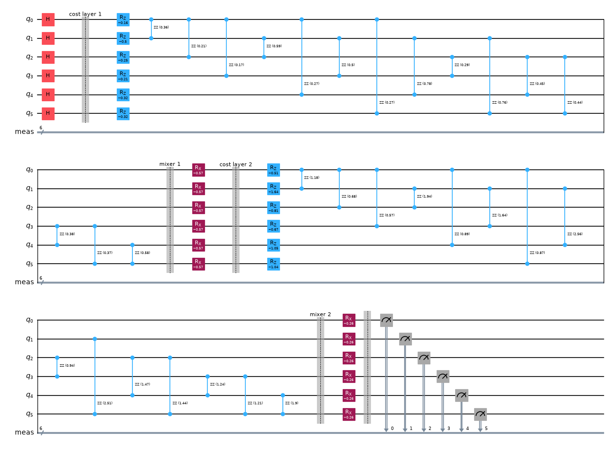

# From a classical QUBO to a quantum circuit

**How GridQ turns "which providers should we switch on?" into a QAOA circuit, and how the circuit's measurements become a dispatch.**

Every step is shown on the real case that ran on IBM's `ibm_kingston`: village `village_n6_s0` at 19:00, with 6 providers and an 11.6 kW shortfall. All numbers in this document are computed by the code in `src/gridq/`, so you can reproduce them.

```
 dispatch problem ──► QUBO ──► Ising Hamiltonian ──► QAOA circuit ──► measure ──► repair ──► dispatch
   (classical)       (0/1)       (qubits, Z, ZZ)      (H, RZ, ZZ, RX)   (shots)    (classical)
       §1             §2              §3                   §4              §5          §6
```

---

## 1 · The classical problem

At 19:00 the village needs **D = 11.6 kW** more than solar and wind supply. There are 6 flexible providers:

| i | Provider | Type | pᵢ (kW) | cᵢ (₹ for the hour) |
|---|---|---|---|---|
| 0 | Household 0 | demand response | 2.3 | 29.3 |
| 1 | Water Pump 1 | diesel | 6.6 | 179.5 |
| 2 | Household 2 | battery | 3.8 | 23.0 |
| 3 | Cold Store 3 | battery | 3.2 | 16.5 |
| 4 | Household 4 | battery | 5.0 | 22.0 |
| 5 | School 5 | battery | 4.9 | 30.2 |

**Decision:** for each provider, xᵢ = 1 (switch on) or 0 (off).
**Goal:** minimise the cost Σ cᵢxᵢ **subject to** supply Σ pᵢxᵢ ≥ D.

This is a minimum-cost covering (knapsack-type) problem with 2⁶ = 64 possible decisions. The true optimum, found by checking all 64, is **providers 2, 3 and 4**: 12.0 kW for ₹61.5.

---

## 2 · Step 1: write it as a QUBO

A **QUBO** (Quadratic Unconstrained Binary Optimisation) is one formula over 0/1 variables, using single terms and pair terms only:

$$H(x) = \sum_i Q_{ii}\,x_i + \sum_{i<j} Q_{ij}\,x_i x_j + \text{const}, \qquad x_i \in \{0,1\}$$

"Unconstrained" means the rule "supply ≥ D" can't be a separate condition. It has to go *into* the formula as a **penalty**.

### Our QUBO (`gridq.qubo.build_qubo`)

$$
H(x) \;=\; \underbrace{A\Big(\sum_i \tfrac{p_i}{D}\,x_i - 1\Big)^2}_{\text{balance penalty}} \;+\; \underbrace{\sum_i \tilde c_i\, x_i}_{\text{cost}}
$$

- **pᵢ/D** is each provider's share of the shortfall. Here that's 0.198, 0.569, 0.328, 0.276, 0.431 and 0.422.
- **c̃ᵢ = cᵢ / Σc** is the cost scaled so all costs sum to 1. Here that's 0.098, 0.597, 0.077, 0.055, 0.073 and 0.101.
- **A = 20.** This is the penalty weight, large enough that missing the shortfall always costs more than any saving.

The penalty is **zero** when the switched-on kW equals D exactly, and grows fast when supply is too low or too high.

### Expanding the square: where the pairs come from

Because xᵢ² = xᵢ for 0/1 variables:

$$A\Big(\sum_i r_i x_i - 1\Big)^2 = A\Big[\sum_i (r_i^2 - 2r_i)\,x_i \;+\; \sum_{i<j} 2 r_i r_j\, x_i x_j \;+\; 1\Big], \qquad r_i = p_i/D$$

So the QUBO matrix entries are:
- **Diagonal (one provider):** Qᵢᵢ = A(rᵢ² − 2rᵢ) + c̃ᵢ
- **Off-diagonal (every pair):** Qᵢⱼ = 2A·rᵢ·rⱼ

For our case:

```
        0       1       2       3       4       5
0   -7.047   4.512   2.598   2.188   3.419   3.350
1           -15.687  7.455   6.278   9.810   9.614
2                   -10.881  3.615   5.648   5.535
3                            -9.458  4.756   4.661
4                                   -13.452  7.283
5                                           -13.227      constant = 20.0
```

**Every pair has a non-zero entry.** Squaring the balance term couples each provider with every other one: if provider 4 is on, provider 5 is less needed. That's why the quantum circuit ends up with a gate between every pair of qubits (§4).

### The QUBO's lowest energies

| x₀…x₅ | Providers on | kW | ₹ | H(x) |
|---|---|---|---|---|
| 001110 | 2, 3, 4 | 12.0 | 61.5 | **0.228** ← minimum (= true optimum) |
| 001101 | 2, 3, 5 | 11.9 | 69.7 | 0.245 |
| 101010 | 0, 2, 4 | 11.1 | 74.3 | 0.284 (short of 11.6) |
| 100011 | 0, 4, 5 | 12.2 | 81.5 | 0.325 |
| 101001 | 0, 2, 5 | 11.0 | 82.5 | 0.328 (short) |

The worst combination scores H = 31.0. Low H means a cheap dispatch close to the shortfall. Some low-H combinations are slightly *short* (11.1 kW): the squared penalty can't tell "slightly under" from "slightly over". §6 fixes this.

Code: `build_qubo(grid)` → `qubo.Q`, `qubo.offset`; `qubo.to_quadratic_program()` gives the same model as a `qiskit_optimization.QuadraticProgram`.

---

## 3 · Step 2: QUBO → Ising Hamiltonian (bits become qubits)

A qubit measured in the Z basis gives eigenvalue **zᵢ = +1** (state |0⟩) or **−1** (state |1⟩). Substitute

$$x_i = \frac{1 - Z_i}{2}$$

so x = 0 ↔ |0⟩ and x = 1 ↔ |1⟩. The QUBO becomes an **Ising Hamiltonian**, an operator made only of Z's:

$$H_C = \sum_i h_i\, Z_i \;+\; \sum_{i<j} J_{ij}\, Z_i Z_j \;+\; \text{const}$$

- A **single term** Qᵢᵢxᵢ becomes a **local field** hᵢZᵢ.
- A **pair term** Qᵢⱼxᵢxⱼ becomes a **coupling** JᵢⱼZᵢZⱼ. It also adds to hᵢ and hⱼ, because (1−Zᵢ)(1−Zⱼ)/4 = (1 − Zᵢ − Zⱼ + ZᵢZⱼ)/4.

Qiskit does this in `QuadraticProgram.to_ising()`, producing a `SparsePauliOp`. For our case that's **21 terms: 6 Z fields + 15 ZZ couplings** (15 = 6·5/2, every pair).

### Normalisation

We divide every coefficient by the largest one (×1/2.452 here), so the largest |coefficient| is 1. This changes nothing about which state is lowest. It keeps the QAOA angles in a similar range for every village, so training behaves the same way each time. (`qubo.to_ising(normalise=True)` returns the operator, the offset and the scale.)

Normalised coefficients for our case:

| Field | h₀ | h₁ | h₂ | h₃ | h₄ | h₅ |
|---|---|---|---|---|---|---|
| value | −0.201 | −0.642 | −0.315 | −0.263 | −0.409 | −0.407 |

| Coupling | J₀₁ | J₀₂ | J₁₂ | J₁₄ | J₁₅ | J₄₅ | … |
|---|---|---|---|---|---|---|---|
| value | 0.460 | 0.265 | 0.760 | **1.000** | 0.980 | 0.742 | (15 in total) |

The largest couplings involve the big providers (1, 4, 5). Switching on two big ones together overshoots the shortfall, so the Hamiltonian discourages it most strongly.

### The key property

**Every one of the 64 basis states |x₀…x₅⟩ is an eigenstate of H_C, and its energy equals the QUBO value H(x)** (after scale and offset). For the optimum |001110⟩, the Ising energy is 0.0931; × 2.452 scale = **0.2284**, the same as H(x) in §2. The test suite checks this for all states (`test_ising_diagonal_is_affine_in_qubo_energy`).

So **"find the cheapest dispatch" = "find the lowest-energy state of H_C"**, the ground state. That's a question a quantum computer can work on.

**Bit order:** Qiskit counts qubits from the right. The measured string `011100` means q₅…q₀ = 0,1,1,1,0,0, so qubits 2, 3 and 4 are 1: providers 2, 3 and 4 on.

---

## 4 · Step 3: Ising Hamiltonian → QAOA circuit

**QAOA** (Quantum Approximate Optimisation Algorithm) prepares a quantum state that is weighted towards low-energy states of H_C. It uses p layers, each with two parts:

$$|\gamma,\beta\rangle \;=\; \prod_{k=1}^{p} \underbrace{e^{-i\beta_k \sum_i X_i}}_{\text{mixer}}\;\underbrace{e^{-i\gamma_k H_C}}_{\text{cost}}\; |+\rangle^{\otimes n}$$

Each piece becomes simple gates:

| Piece | Gate(s) | Why | In the problem |
|---|---|---|---|
| \|+⟩⊗ⁿ | **H** on every qubit | equal superposition of all 2ⁿ states | "consider every dispatch at once" |
| e^(−iγ hᵢZᵢ) | **RZ(2γhᵢ)** on qubit i | the phase depends on whether provider i is on | provider i's cost and kW |
| e^(−iγ JᵢⱼZᵢZⱼ) | **RZZ(2γJᵢⱼ)** on qubits i, j | the phase depends on whether i and j are on together | the balance coupling between i and j |
| e^(−iβXᵢ) | **RX(2β)** on every qubit | mixes amplitudes between neighbouring states | lets probability flow towards cheaper dispatches |
| measure | **M** on every qubit | collapses to one basis state | one candidate dispatch per shot |

**Intuition:** the cost layer gives each dispatch a phase proportional to its energy. The mixer turns those phase differences into amplitude differences through interference. With well-chosen γ and β, the amplitudes of cheap dispatches grow and those of expensive ones shrink.

### Our circuit: 6 qubits, p = 2 (the one sent to `ibm_kingston`)



- 6 **H**, then for each layer: 6 **RZ** + 15 **ZZ** + 6 **RX**; then 6 measurements.
- Totals: **30 ZZ** two-qubit gates, 12 RZ, 12 RX, depth 24.
- The angles on the gates are 2γhᵢ, 2γJᵢⱼ and 2β, using the **trained** values γ = (0.389, 1.278) and β = (−0.286, −0.130).

Code: `gridq.qaoa.readable_circuit(qubo, params)` builds exactly this gate-by-gate circuit (a test checks it equals Qiskit's `QAOAAnsatz`). The solver itself uses `QAOAAnsatz(H_C, reps=p)`.

### Training the angles (classical, free)

γ and β are found by a classical optimiser, **COBYLA**, which repeatedly asks "how good is the state for these angles?":
- **Objective: CVaR(α = 0.25).** The average energy of the best 25% of outcomes. It rewards concentrating probability on the very best dispatches, and gave about 20–40% better results than the plain average.
- **Start:** a coarse grid search for p = 1, then the **INTERP** rule to extend good angles from depth p to p + 1.
- **Evaluation:** during training we compute the circuit's output exactly on the CPU with a fast NumPy simulator (`fast_qaoa_probs`, checked against Qiskit's `Statevector`). That's cheap at ≤ 12 qubits and uses no hardware credits.

The trained circuit is then **sampled**: on Qiskit Aer (ideal), Aer with IBM's noise model, or a real IBM QPU through `SamplerV2`.

### On a real chip: compiling

IBM Heron chips run only native gates (**CZ, SX, RZ, X**), and each qubit is wired only to its neighbours in a heavy-hex lattice. The transpiler (optimisation level 3) therefore:
1. rewrites every H, RX and RZZ into native gates;
2. picks 6 well-calibrated physical qubits (for example 136 and 141–145 on a Heron);
3. adds **SWAP** gates so every pair that needs a ZZ interaction becomes adjacent at some point.

Result: **30 ZZ → 105 CZ gates, two-qubit depth 30 → 77.** The problem's all-to-all couplings (§2) are why the circuit grows so much on real hardware, and why noise matters.

---

## 5 · Step 4: measurement (quantum → classical samples)

Each run of the circuit (one **shot**) collapses to one basis state: one 6-bit dispatch. We take 4,096 shots and count how often each of the 64 dispatches appears.

| | P(optimal dispatch) per shot | vs random guessing (1/64 = 1.56%) |
|---|---|---|
| Ideal simulator | 4.41% | **2.82×** |
| IBM noise model (FakeFez) | 3.71% | 2.38× |
| **Real `ibm_kingston`** | **3.71%** | **2.38×** |
| Random guessing | 1.56% | 1.00× |

So the circuit **concentrates probability on the optimum** (and on other cheap dispatches), even on real hardware. With p = 2 it's a *bias* rather than a guarantee. The optimum isn't the single most frequent outcome, so we look at all the samples (§6).

---

## 6 · Step 5: back to a classical decision (feasibility repair)

Two problems remain:
1. Some samples are **short of D**, because the squared penalty can't encode "≥" (§2) and noise produces junk samples.
2. We need **one** dispatch, not 4,096 samples.

`gridq.classical.repair(grid, x)` turns any sample into a usable dispatch:
1. **While short:** switch on the off provider with the lowest cost per kW.
2. **Trim:** switch off on-providers, most expensive first, if supply still covers D and cost goes down.

QAOA repairs **every distinct sampled dispatch and keeps the cheapest**. For our case that's **providers 2, 3 and 4, 12.0 kW, ₹61.5**: the true optimum, on the ideal simulator, the noise model and real `ibm_kingston` alike.

**Fairness:** every classical solver (simulated annealing, greedy, greedy descent, random sampling) gets the **same** repair, so the comparison is like for like. The honest measure of the quantum part is the enrichment in §5, measured *before* repair.

---

## 7 · Summary: the whole translation in one table

| Classical concept | Quantum counterpart | Our 6-provider case |
|---|---|---|
| provider i on/off (xᵢ ∈ {0,1}) | qubit i measured as \|1⟩/\|0⟩ | 6 qubits |
| all 2ⁿ possible dispatches | basis states, all in superposition after H | 64 states |
| QUBO energy H(x) | eigenvalue of the Ising Hamiltonian H_C | optimum: H = 0.228 |
| one-provider term (cost, kW) | local field hᵢZᵢ → **RZ** gate | 6 RZ per layer |
| pair term (balance coupling) | coupling JᵢⱼZᵢZⱼ → **ZZ** gate | 15 ZZ per layer (every pair) |
| "find the cheapest dispatch" | "find the ground state of H_C" | \|001110⟩ = providers 2, 3, 4 |
| search moves between dispatches | mixer **RX(2β)** | 6 RX per layer |
| tuning the search | classical optimiser (COBYLA, CVaR) for γ, β | p = 2 → 4 angles |
| try many candidates | measure many shots | 4,096 shots |
| make the answer valid | classical repair + pick cheapest | ₹61.5 ✅ optimal |

---

## 8 · Honest limitations

- **At this size classical wins.** 64 (or 4,096) combinations is trivial for brute force. The value here is showing the full pipeline working end to end on real hardware, not a speed-up.
- **Formulation gap.** The squared penalty treats "short" and "over" equally, so the QUBO optimum plus repair is sometimes not the true optimum. Over 45 test instances it was exact 56% of the time, with a mean gap of 2.4%. Encoding "≥" exactly needs extra slack qubits.
- **All-to-all couplings.** The balance term links every pair of providers, so circuits grow quickly on chips with nearest-neighbour wiring (30 → 105 two-qubit gates here). Our density study (README §4.3) shows that simply dropping couplings breaks the problem.
- **Shallow circuits.** On today's hardware, p ≈ 2 is the useful limit: deeper circuits add more noise than signal.

---

## 9 · Where each step lives in the code

| Step | Function | File |
|---|---|---|
| Problem data | `make_microgrid`, `load_village(...).microgrid(hour)` | `src/gridq/data.py` |
| QUBO | `build_qubo`, `Qubo.to_quadratic_program` | `src/gridq/qubo.py` |
| Ising Hamiltonian | `Qubo.to_ising` (Qiskit `QuadraticProgram.to_ising`) | `src/gridq/qubo.py` |
| QAOA circuit | `QAOAAnsatz`; readable version `readable_circuit` | `src/gridq/qaoa.py` |
| Training | `optimise_parameters` (COBYLA, CVaR, INTERP), `fast_qaoa_probs` | `src/gridq/qaoa.py` |
| Sampling | `solve_qaoa` (Aer / noise model), `run_qaoa_on_hardware` (IBM QPU) | `src/gridq/qaoa.py`, `src/gridq/hardware.py` |
| Repair | `repair` | `src/gridq/classical.py` |
| See it run | notebook cells 4, 4b and 6; dashboard "Dispatch & compare solvers" and "Real quantum hardware" | `notebooks/demo.ipynb`, `app/streamlit_app.py` |
